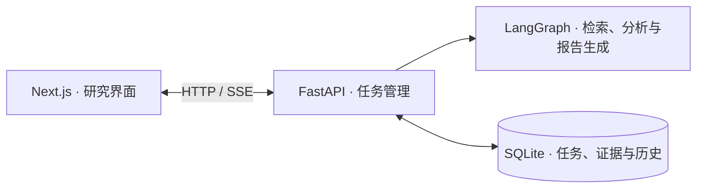

# ResearchAgent

本地优先的 AI 学术研究工作区：从一个问题出发，检索论文、分析证据并生成研究报告。支持中英文、历史任务、论文与引用联动、报告导出及继续追问。

## 界面预览

实际页面截图，工作区使用示例研究数据。点击图片可查看原图。

|                                     首页                                      |                                 功能菜单                                  |
| :---------------------------------------------------------------------------: | :-----------------------------------------------------------------------: |
|           [](assets/readme/home.png)           |       [](assets/readme/menu.png)       |
|                                   新建研究                                    |                                论文工作区                                 |
| [](assets/readme/new-research.png) | [](assets/readme/workspace.png) |

## 快速启动（Windows）

准备 **Python 3.11+（推荐 3.12）** 和 **Node.js 20.9+**，然后克隆仓库：

```powershell
git clone https://github.com/taoguo079-cpu/ResearchAgent.git
cd ResearchAgent
```

1. 双击 `ResearchAgent-启动.bat`，自动创建虚拟环境、安装依赖并启动服务。首次安装需要联网。
2. 打开 [localhost:3000](http://localhost:3000)，按页面提示配置 DeepSeek API Key，即可开始研究。

使用 Anaconda / Miniconda 时，可改为双击 `ResearchAgent-Conda.bat`，自动创建并复用 `research-agent` 环境；仍需安装 Node.js。

首次启动会从 `.env.example` 创建 `.env`，已有配置不会被覆盖。关闭启动窗口即可停止服务。

## 架构



前端位于 [`web/`](web/)，后端位于 [`backend/`](backend/)，本地数据保存在 `data/`。

许可：[GPL-2.0](LICENSE)。
