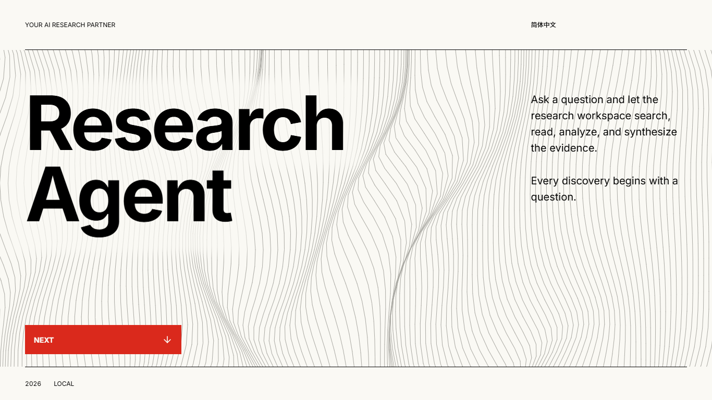
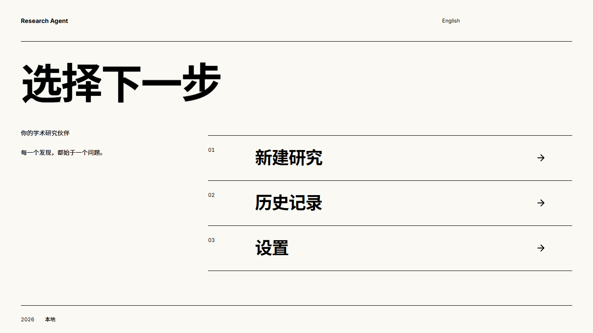
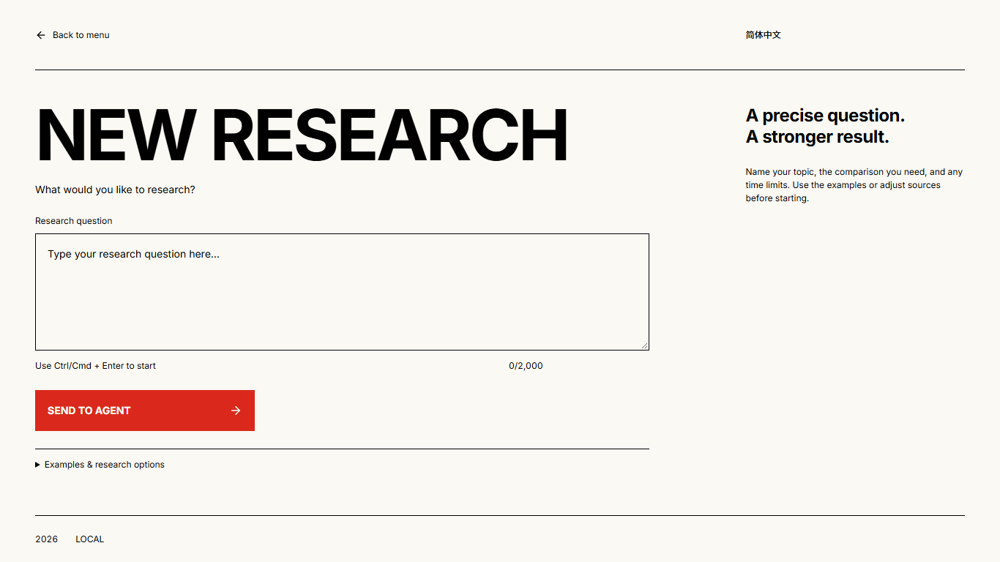
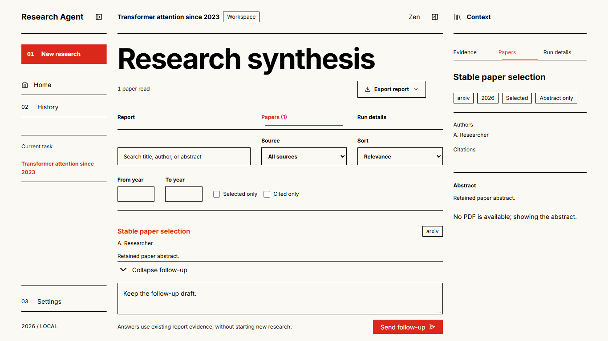
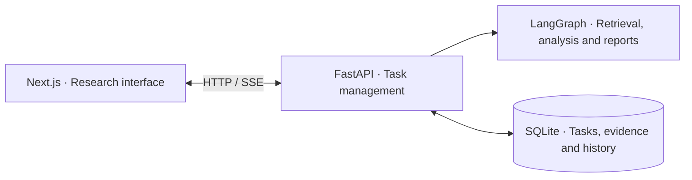

# ResearchAgent

[](README.md) [](README.zh-CN.md)

A local-first AI workspace for academic research. Start with a question, find papers, analyze evidence, and generate a research report. Includes an English and Chinese interface, research history, linked papers and citations, report export, and follow-up questions.

## Interface

Screenshots of the actual interface. The workspace uses sample research data. Click an image to view it at full size.

|                                       Home                                        |                                      Menu                                      |
| :-------------------------------------------------------------------------------: | :----------------------------------------------------------------------------: |
|             [](assets/readme/home.png)             |           [](assets/readme/menu.png)            |
|                                   New research                                    |                                Paper workspace                                 |
| [](assets/readme/new-research.png) | [](assets/readme/workspace.png) |

## Quick start (Windows)

Install **Python 3.11+ (3.12 recommended)** and **Node.js 20.9+**, then clone the repository:

```powershell
git clone https://github.com/taoguo079-cpu/ResearchAgent.git
cd ResearchAgent
```

1. Double-click `ResearchAgent-启动.bat` to create a virtual environment, install dependencies, and start the application. The first installation requires an internet connection.
2. Open [localhost:3000](http://localhost:3000) and follow the prompts to configure your DeepSeek API key, then start your research.

For Anaconda / Miniconda, double-click `ResearchAgent-Conda.bat` instead. It automatically creates and reuses the `research-agent` environment. Node.js is still required.

On first launch, `.env` is created from `.env.example`; existing settings are preserved. Close the launcher window to stop the application.

## Architecture



The frontend is in [`web/`](web/), the backend is in [`backend/`](backend/), and local data is stored in `data/`.

License: [GPL-2.0](LICENSE).
