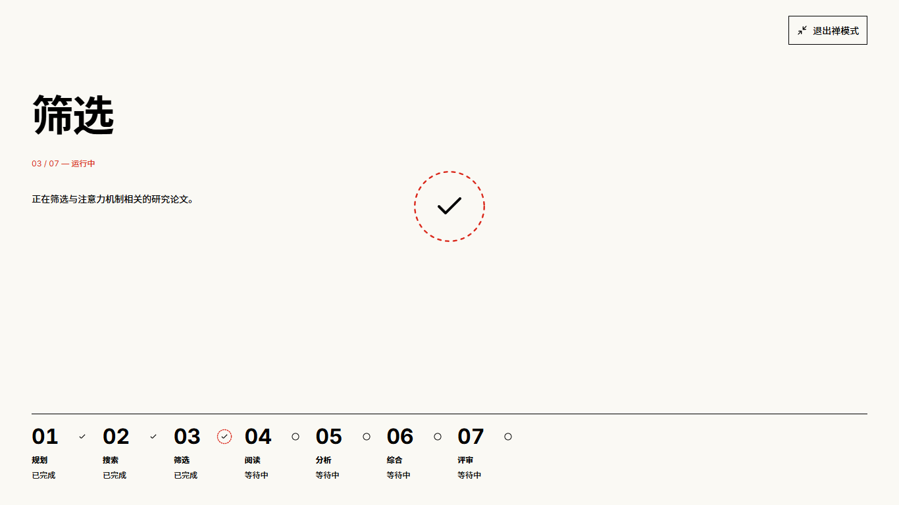

# Agent 阶段加载动效

2026-10-11。用户批准的功能性动效：在七阶段进度条及执行中的禅模式移植小蛇加载效果，保留现有瑞士风格、文字位置、退出按钮及底栏。

## 来源与实现

参考 [JIEJOE-WEB-Tutorial/014-snake-loading](https://github.com/JIEJOE-WEB-Tutorial/014-snake-loading/blob/main/snake%20loading.html) 的 SVG 路径和 GSAP 描边节奏，并在 1366 × 768 实际查看原网站的加载和 START 完成态。适配使用项目既有 GSAP，没有新依赖；MIT 版权全文保留在 `web/public/licenses/snake-loading-MIT.txt`。

- 红色使用 `--color-primary`（#DA291C），圆头虚线沿“8”字路径以 2 秒循环，直至真实阶段完成。
- 700ms 收拢为无填充红色虚线圆圈和黑色 Lucide Check。下一阶段开始后圆环在自己的遮罩中向下移出，300ms 结束；底栏的 √ 不移动。中央旧 √ 在退场末尾淡出，由当前阶段加载接替。
- 普通底栏动画槽 40 × 24px，禅模式底栏 48 × 24px；所有状态与数字间隔 12px。中央画布 240 × 120px，居中于底栏上方的主区域，左侧说明与画布边缘相距至少 32px。
- 任务级控制器只读取已有 ReplayState。进度文字更新不重启；阶段完成与下一阶段开始在同一批渲染中仍会保留旧阶段收拢，新阶段立即运行。attempt 或真实 startedAt 改变、停止后恢复运行时开启新周期。
- 前台时钟冻结后台时间；活动指示器离开视口后暂停 GSAP，卸载清理时间线、定时器、媒体查询监听和观察器。减少动态效果时使用静态反馈，完成态立即切换。
- 首次打开已有完成阶段不重演历史动效。待执行、告警、失败及停止沿用静态状态图标；中断时停掉循环。报告阅读禅模式保持原有布局。

定时器包含提前唤醒重调度：浏览器对小数毫秒的取整不能让收拢阶段失去结束回调。

## 桌面验收与截图来源

以下均为本次源码在真实 Chrome 中以原生 1366 × 768 视口捕获的未修饰截图，页面内容及 SSE 事件由浏览器测试中的隔离模拟数据驱动。未调用真实研究提供商；移动端视觉匹配不在本次范围。两轮集中视觉检查确认尺寸、遮挡、正文间距及完成标识；另对发现的定时器边界进行了功能回归。

| 场景                     | 中文                                                     | 英文                                                  |
| ------------------------ | -------------------------------------------------------- | ----------------------------------------------------- |
| 普通进度条加载           | [截图](screenshots/stage-loading/rail-loading-zh-CN.png) | [截图](screenshots/stage-loading/rail-loading-en.png) |
| 禅模式加载               | [截图](screenshots/stage-loading/zen-loading-zh-CN.png)  | [截图](screenshots/stage-loading/zen-loading-en.png)  |
| 禅模式完成               | [截图](screenshots/stage-loading/zen-complete-zh-CN.png) | [截图](screenshots/stage-loading/zen-complete-en.png) |
| 下阶段加载、旧阶段仅剩 √ | [截图](screenshots/stage-loading/zen-next-zh-CN.png)     | [截图](screenshots/stage-loading/zen-next-en.png)     |

自然播放原始录屏保存在本机生成产物目录，不变速、不拼接、没有设置动画播放进度，包含至少一个完整的中央 2 秒循环：

- `artifacts/stage-loading-qa/recordings/stage-loading-zh-CN.webm`
- `artifacts/stage-loading-qa/recordings/stage-loading-en.webm`

## 验证结果

| 命令                                                                                                                        | 结果                                                    |
| --------------------------------------------------------------------------------------------------------------------------- | ------------------------------------------------------- |
| `npm --prefix web run test -- --run`                                                                                        | 49 个文件，270 项通过                                   |
| `PW_REUSE_SERVER=1 npm --prefix web run test:e2e -- stage-loading.spec.ts research-focus.spec.ts report-navigation.spec.ts` | 9 项通过；PowerShell 使用 `$env:PW_REUSE_SERVER='1'`    |
| `npm --prefix web run typecheck -- --incremental false`                                                                     | 通过；原有增量缓存文件写入受限，禁用增量避免覆盖该缓存  |
| `npm --prefix web run lint`                                                                                                 | 通过                                                    |
| `npm --prefix web run format:check`                                                                                         | 通过                                                    |
| `npm --prefix web run i18n:check`                                                                                           | 通过                                                    |
| `npm --prefix web run build`                                                                                                | 通过；既有菜单 CSS 的 4 个 `::highlight` 解析警告仍存在 |
| impeccable detector，覆盖本次 7 个实现目标                                                                                  | 执行一次，返回 `[]`                                     |

浏览器验证包括红色描边实际移动、无填充、黑色 √、圆环下移、√ 坐标不变、快速交接不吞动画、长说明避让、减少动态效果、键盘退出、焦点恢复及单一 SSE 连接。既有回归确认草稿保留、报告切换和论文阅读正常。组件及状态测试覆盖初始快照、重试、告警恢复、失败/取消/中断、后台冻结、提前回调及资源释放。

最终检查结论：可交付。没有后端、API、数据库、依赖或研究语义的改动。
